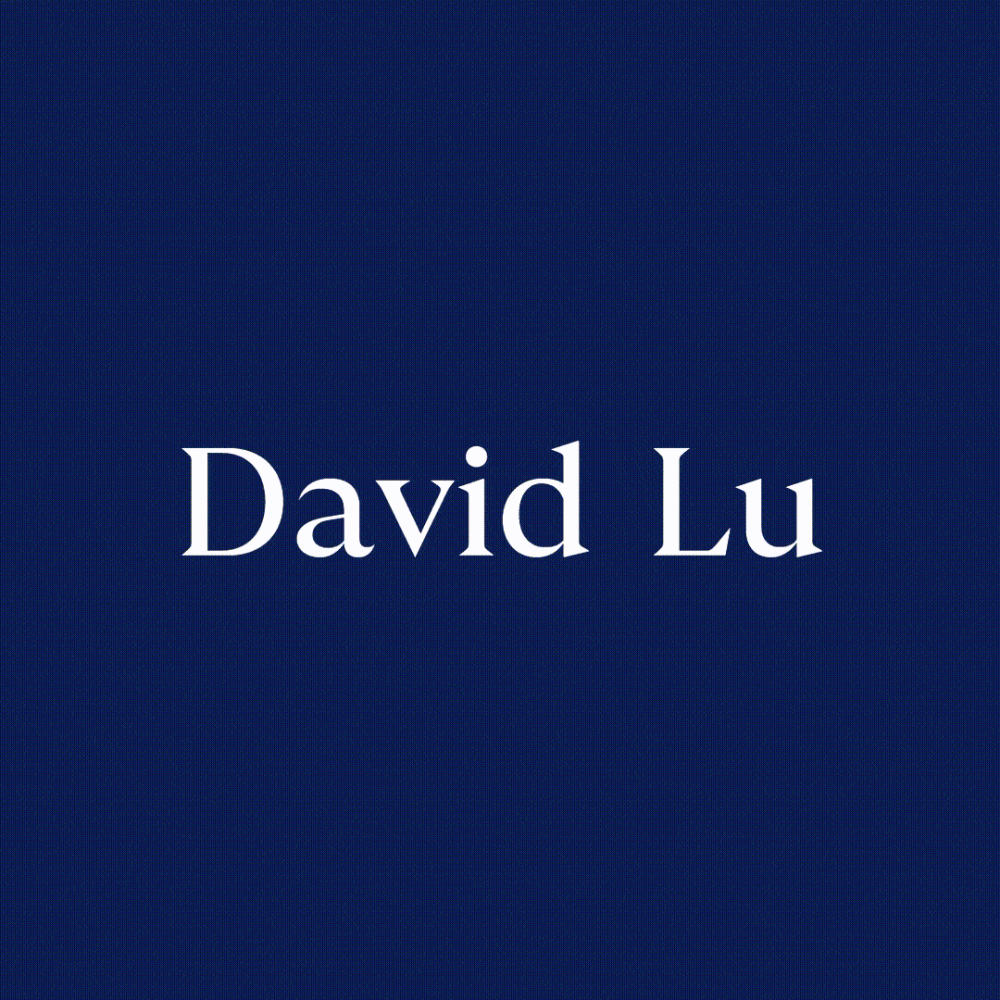

  

  

    
  

  

    
    
  

---

### 🚀 About Me
- 🎓 Final-year Information Technology student at **HUIT** (Ho Chi Minh City, Vietnam)
- 💻 Experienced in full-stack web development (**Next.js**, **Django**, **PostgreSQL**) and **Data/ML** pipelines
- 🤖 Actively building **AI Coding Agent** workflows with **MCP (Model Context Protocol)**, **Spec-Driven Development**, and **Local LLMs**
- 🌱 Currently developing and scaling **[Tomato Active English](https://tomato-ae.edu.vn)** LMS in production

---

### 🛠️ Tech Stack

**Languages & Frameworks**  

**Databases, Cloud & AI Ecosystem**  

---

### 📌 Featured Engineering Projects

| Project | System Architecture & Key Highlights | Tech Stack |
| :--- | :--- | :--- |
| **[Tomato Active English](https://tomato-ae.edu.vn)** | Production Learning Management System handling course delivery, student tracking, and automated educational workflows. | `Next.js` `Django` `NeonDB` `Cloudflare` |
| **[Sephora Recommendation System](https://github.com/DavidLu18/Sephora_Project)** | Personalized e-commerce search & product recommendation engine featuring hybrid filtering and cloud media storage. | `Django` `Next.js` `PostgreSQL` `Cloudflare R2` |
| **[Stock Market Prediction](https://github.com/DavidLu18/Stock-Market-Prediction)** | End-to-end time-series data preprocessing pipeline and machine learning models for financial trend forecasting. | `Python` `Pandas` `Scikit-Learn` `ML` |
| **AI Agent & MCP Architecture** | Spec-driven multi-agent development setup integrating MCP servers, automated rules, and quantized local LLMs. | `MCP` `Kilo Code` `OpenCode` `Qwen / DeepSeek` |

---

### 📊 GitHub Analytics

  
  

 

  

