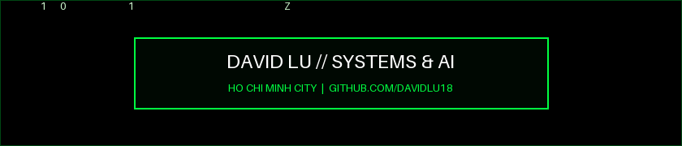

  

   

  

---

### `01 // ABOUT`
Final-year Information Technology student at **HUIT** (Ho Chi Minh City, Vietnam) focused on **Full-Stack Web Engineering**, **Data/ML Pipelines**, and **AI-Assisted Developer Workflows**. Currently maintaining **[Tomato Active English](https://tomato-ae.edu.vn)** in production while architecting multi-agent coding setups with **Model Context Protocol (MCP)** and local quantized LLMs.

---

### `02 // SELECTED_WORK`

| Project | Architecture & Engineering Scope | Stack |
| :--- | :--- | :--- |
| **[Tomato Active English](https://tomato-ae.edu.vn)** | Production Learning Management System handling course delivery, student tracking, and automated workflows on edge CDN. | `Next.js` `Django` `NeonDB` `Cloudflare` |
| **[Sephora Recommendation System](https://github.com/DavidLu18/Sephora_Project)** | Personalized e-commerce search and product recommendation engine with hybrid filtering and object storage integration. | `Django` `Next.js` `PostgreSQL` `Cloudflare R2` |
| **[Stock Market Prediction](https://github.com/DavidLu18/Stock-Market-Prediction)** | End-to-end time-series preprocessing pipeline and supervised machine learning models for market trend forecasting. | `Python` `Pandas` `Scikit-Learn` |
| **Spec-Driven AI Agent Setup** | Multi-agent development workflow integrating MCP servers, automated rulesets, and local inference (`Qwen`, `DeepSeek`). | `MCP` `Kilo Code` `OpenCode` |

---

### `03 // CORE_STACK`

---

### `04 // TELEMETRY`

